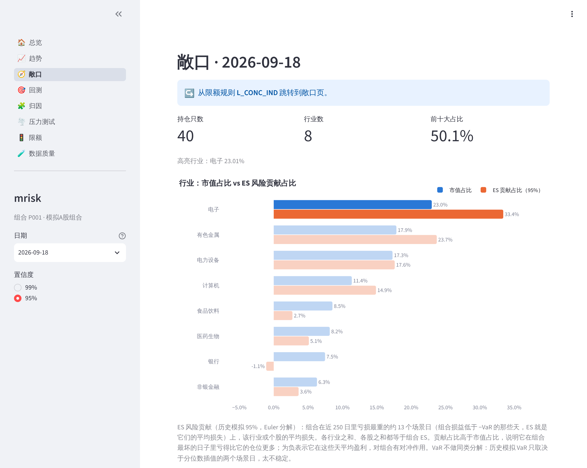
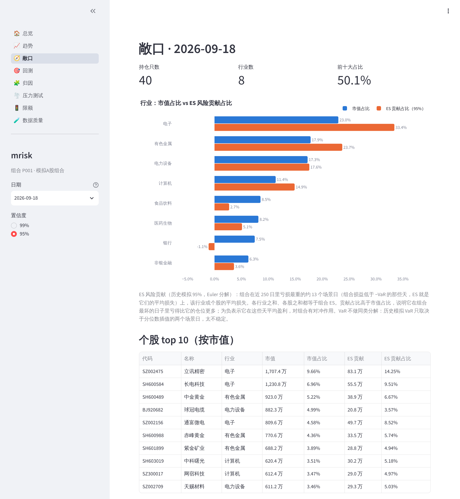
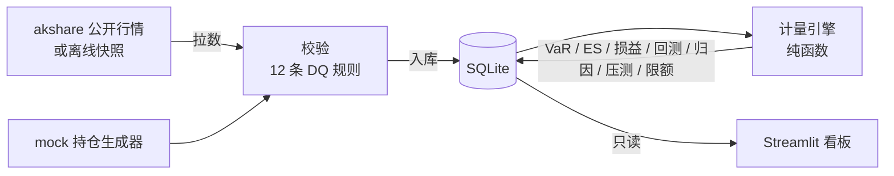

# mrisk — A 股股票组合的市场风险系统

**虚构组合在真实市场里的真实风险。** 行情是真的：经 akshare 取自公开网站的 A 股日线（2015-01 至 2026-09，81 只股票，含一只跨越 920 号段切换的北交所股票）。持仓是假的：由 mock 生成器造的 40 只股票的组合，2024-09-02 至 2026-09-18 共 497 个持仓日。

项目参考券商市场风险系统的典型功能，用公开方法论自己设计。离线快照约 16 MB，下载后 3 分钟跑完整条流程，不用联网，结果与作者本机用实时数据建的库逐位相同。


*总览（2026-09-18，99%）：顶部一行数据状态（行情和持仓截至日期、来源、DQ 门禁）；市值、两种 VaR、ES 及对上一日的变动；5 条限额中 2 条预警并标出已持续天数；每条规则一键跳到解释它的页面。*

## 它每天回答四个问题

| 问题 | 怎么回答 | 看板页面 |
|---|---|---|
| 组合值多少钱，风险在哪里？ | 个股 / 行业 / 组合三层市值与集中度；**ES 风险贡献**（Euler 分解）指出组合最坏的日子亏在谁身上 | 总览、敞口 |
| 明天最坏亏多少？ | VaR（历史模拟法、参数法）和 ES，95% 与 99% 都算；1 日持有期，250 日窗口；每天的变化分解为持仓、规模、权重漂移、窗口四项 | 总览、趋势、归因 |
| 这个"最坏"靠不靠谱？ | 用假设损益回测：Kupiec 似然比检验、Christoffersen 独立性检验、巴塞尔红绿灯（边界由二项分布推出） | 回测 |
| 有没有碰到红线？ | 3 个历史情景（2015 股灾、2018 回调、2020 疫情）+ 18 个假设情景；5 条限额每日检查，预警 / 突破分开计天 | 压力测试、限额 |

数据进库前要过 12 条 DQ 规则，其中 6 条 blocking：失败时按作用域拦下受影响的日期，看板顶部写明哪天、哪条规则（数据质量页）。

## 关键结果（2024-09-02 至 2026-09-18，497 个持仓日）

- **回测**：历史模拟 99% 在 496 个观测里出现 11 次例外，期望 5 次，全样本单侧二项检验 p = 0.0125，模型在这段行情里偏激进；参数法 99% 为 9 次（p = 0.0645）；95% 的两种方法与期望没有显著差别；全程没有红灯。
- **压力测试**：2015 股灾情景下，组合损失占市值 36.3%–41.5%（随持仓日变化），限额定在 45%。
- **风险集中在哪里**：2026-09-18，电子、有色金属两个行业合计占市值 41%，在 95% 下贡献了 57% 的 ES。银行的 ES 贡献是 −1.1%：组合最坏的 13 天里，银行股平均是赚钱的，起对冲作用。
- **限额**：497 天 × 5 条 = 2,485 次检查，正常 2,055、预警 383、突破 47；突破全部来自单只股票集中度。

推导和更多数字见 [docs/overview.md](docs/overview.md) 和各周设计说明。

## 看板一览

8 个页面：总览、趋势、敞口、回测、归因、压力测试、限额、数据质量。看板只读库，不重算任何风险数字。

**限额一键带上下文跳转。** 总览页和限额页的每条规则都能跳到解释它的页面，并带上日期、置信度和焦点：

- 集中度规则 → 敞口页，高亮相关个股或行业；
- VaR / ES 规则 → 归因页，选好指标和置信度；
- 情景损失规则 → 压力测试页，选中该情景。

链接可以刷新、可以分享。


*从 L_CONC_IND（单一行业集中度）跳到敞口页：被检查的电子行业保持实色，其余变淡；页顶写明从哪条规则跳来。*

**ES 风险贡献。** 敞口页把每个行业、每只股票对组合 ES 的贡献，与它的市值占比并排显示。贡献 = 组合尾部场景日上该股损益平均值的相反数，各股之和精确等于组合 ES。

- VaR 不做同类分解：历史模拟 VaR 只取决于两个场景日，95% 下的 Euler 分量在 496 天里有 159 天日换手超过 10%，ES95 只有 3 天。
- 99% 的尾部只有约 3 天，页面会提示：稳定的读数以 95%（约 13 天）为准。


*敞口（95%）：电子行业占市值 23.0%，却贡献了 33.4% 的 ES；银行占 7.5%，贡献为负。*


*回测（95%，滚动 250 个观测）：历史模拟 19 次例外、黄灯，参数法 13 次、绿灯；红绿灯边界由二项分布按 (p, 窗口) 推出。*


*压力测试：8 个行业各 −10% 时，β 传导（近 250 日相关结构下的条件期望）与"其余不变"的损失并排对比。*

## 10 分钟上手（离线样例）

需要 [uv](https://docs.astral.sh/uv/) 和 Python 3.11+。

```sh
git clone https://github.com/wjx-chloe/mrisk.git
cd mrisk
uv sync
uv run mrisk fetch-snapshot                         # 下载行情快照（约 16 MB）并校验 sha256，唯一联网的一步
uv run mrisk demo                                   # 用快照跑完整条流程，写 data/demo.db，全程不联网
uv run mrisk --config config.demo.yaml dashboard    # 打开看板
```

- `fetch-snapshot` 从本仓库的 GitHub Release 下载 `mrisk-snapshot-20260918.zip`，按 `config.demo.yaml` 里记录的 sha256 校验，再逐个文件核对清单后解压到 `data/snapshot/`。
- `demo` 依次执行回灌（日历、证券、行情、mock 持仓、12 条 DQ 规则）→ VaR / ES → 假设损益 → 回测 → 归因 → 压测 → 限额，覆盖全部 497 个持仓日。本机实测约 3 分钟，其中压测约 100 秒。再跑一次要加 `--overwrite`。
- 离线跑出来的库与作者本机用实时数据建的库**逐表逐行、逐位相同**（`uv run mrisk diff-db data/mrisk.db data/demo.db`，只排除 `run_id` 等运行元数据），所以 docs 里的数字都能在 demo 库上复现。
- **之前版本建的库**（例如更新代码前跑过的 `data/demo.db`）缺少新加的列时，看板会提示先运行 `uv run mrisk upgrade-db`（加 `--config` 指向那个库的配置）。它会就地补列、只补算新列，不用重建库。

### 看板只允许本机访问

`mrisk dashboard` 以仓库根目录为工作目录启动 Streamlit，并显式传 `--server.address localhost`、关闭使用统计，从哪个目录启动都一样。需要在局域网里打开时，单次运行指定地址：

```sh
uv run mrisk --config config.demo.yaml dashboard --address 0.0.0.0
```

## 数据流



数据只朝一个方向走：拉数 → 校验 → 入库；所有计算只从库里读，不在计算过程中现场拉行情。DQ 门禁拦下的日期不出风险结果，看板顶部会显示原因。

## 设计上的几个取舍

- **引擎是纯函数**：只吃 DataFrame / ndarray，不碰库、文件、网络，所以能用手算的小样本直接测。计算函数都配手算或极小样本的测试；3 只股票的手算 VaR / ES 与程序结果对到小数点后 4 位。
- **全部向量化**：引擎里不按日期循环；50 只股票 × 250 天，三层、两个置信度的全部指标单次计算约 70 毫秒（验收线 1 秒）。
- **VaR 不可加，测试里显式验证**：个股、行业、组合三层 VaR 之和不等于组合 VaR，这是允许的。可加的分解（归因的四项效应、ES 的 Euler 贡献）都有恒等式测试守着。
- **920 号段**：北交所股票换代码前后是同一个主键，旧代码经映射表解析，不会变成两只股票。
- **DQ 门禁按作用域**：持仓类规则失败只拦当天，价格类拦下所有包含坏价格的 251 天窗口，静态类拦全部；门禁和失效删除读同一份依赖声明，两者永远一致。
- **可复现**：离线快照保留原始 akshare 返回，回放结果与实时库逐位相同；库结构升级时就地补列、逐位核对后才写入。

## 模块与文档

| 模块 | 代码 | 设计说明 |
|---|---|---|
| 数据管道：行情、证券主数据、920 号段映射、mock 持仓、12 条 DQ 规则与门禁 | `src/mrisk/data/`、`src/mrisk/jobs/etl.py`、`src/mrisk/jobs/gate.py` | [docs/week1-data-pipeline.md](docs/week1-data-pipeline.md) |
| 计量引擎：市值、收益率、VaR（历史模拟 / 参数法）、ES、个股 / 行业 / 组合三层 | `src/mrisk/engine/` | [docs/week2-engine.md](docs/week2-engine.md) |
| 回测与差异归因 | `src/mrisk/engine/backtest.py`、`src/mrisk/engine/attribution.py` | [docs/week3a-backtest-attribution.md](docs/week3a-backtest-attribution.md) |
| 压力测试与限额 | `src/mrisk/engine/stress.py`、`src/mrisk/limits/` | [docs/week3b-stress-limits.md](docs/week3b-stress-limits.md) |
| 监控看板（8 个页面） | `src/mrisk/dashboard/` | [docs/week4a-dashboard.md](docs/week4a-dashboard.md) |
| 离线快照、demo、回放核对 | `src/mrisk/data/snapshot.py`、`src/mrisk/jobs/demo.py`、`src/mrisk/db/compare.py` | [docs/week4b-offline-demo.md](docs/week4b-offline-demo.md) |
| 看板产品化：数据状态、限额跳转、ES 风险贡献、旧库升级 | `src/mrisk/engine/var.py`、`src/mrisk/dashboard/`、`src/mrisk/db/repo.py` | [docs/dashboard-productization.md](docs/dashboard-productization.md) |

需求规格见 [SPEC.md](SPEC.md)；一页总览（架构、数据流、关键数字、各周文档索引）见 [docs/overview.md](docs/overview.md)。

## 切回 akshare 实时拉数

`config.yaml` 是实时配置（`data.source: akshare`，库在 `data/mrisk.db`）：

```sh
uv run mrisk backfill --end 2026-09-18   # 全量回灌：日历、证券、行情、持仓、DQ
uv run mrisk risk --start 2024-09-02 --end 2026-09-18   # 其余各步同理：pnl / backtest / attribution / stress / limits
uv run mrisk daily                       # 增量跑一天：拉数 → DQ → 门禁通过才算风险
uv run mrisk schedule                    # 每个工作日 16:30（北京时间）自动跑 daily
uv run mrisk upgrade-db                  # 旧版本建的库：就地补列，只补算新列
uv run mrisk dashboard
```

- akshare 是非官方数据源，会限流、会缺数据：拉数间隔 1 秒并带重试，原始返回缓存在 `data/raw/`。申万成分接口很慢，31 个行业约 25 分钟。
- 本机有 HTTPS 代理时访问国内行情站点可能握手失败，`data.bypass_proxy: true` 会在拉数时绕过代理。
- 从自己的缓存打离线快照：`uv run mrisk export-snapshot`。同一只股票的多个缓存区间重叠部分不一致时，不会挑一个，而是列出来并拒绝打包。

## 已知局限

- **持仓是 mock 的**，没有真实成交，回测只有假设损益。
- **停牌由缺行推断**，不是来自独立的停牌数据源。数据源漏掉个别股票时会被误标为停牌，覆盖率保护只挡得住整批缺失。
- **ST 按当前简称近似**，历史上戴过帽、现已摘帽的股票，当年的 5% 涨跌幅限制识别不了。
- **DQ 门禁按日期判断，不按股票**：任意一只股票的价格类规则失败，会拦下窗口覆盖这一天的所有风险日。偏保守。
- **压测的因子池是股票池内的 81 只**，不是市场指数；未上市、停牌的股票走同行业代理，代理平均无偏，单只股票不准。
- **假设情景每次只冲击一个因子**（`raw` 模式除外）。
- **历史模拟法在样本期偏激进**：95%、99% 的例外都偏多，全样本二项检验下 99% 显著（单侧 p ≈ 0.013），95% 不显著（p ≈ 0.12）。见 [4A 文档 §5](docs/week4a-dashboard.md)。
- **99% 的 ES 贡献只靠约 3 个场景**：平常日子与 95% 相近，但极端日移入或移出窗口时会一次性大幅跳动。见 [看板产品化 §4.4](docs/dashboard-productization.md)。
- **数据来源取自配置**：库本身不记录行情来自 akshare 还是快照。
- **看板的只读只对 SQLite 生效**；换 PostgreSQL 要另配只读账号。
- 不做：债券 / 期权 / 期货、空头、权限与多用户、邮件告警（breach 只写日志并在看板红色高亮）。

## 开发方式

本项目用 Claude Code 开发。[SPEC.md](SPEC.md) 是需求规格，[CLAUDE.md](CLAUDE.md) 是工作守则；每个模块都经作者验收后才进入下一个，各模块的设计说明在 `docs/`。

## 开发

```sh
git config core.hooksPath .githooks              # 提交前跑测试，不过就拒绝提交
uv run pytest -q                                  # 全部测试：273 个（假数据，不联网）
MRISK_REGRESSION_DB=data/demo.db uv run pytest -m slow   # 在 demo 库上核对 docs 里的关键数字
```

## 数据来源与声明

行情经 akshare 取自公开网站，仅供学习研究，权利人要求即删除。持仓和组合均为虚构，不构成任何投资建议。

## 许可

代码以 [MIT 许可](LICENSE) 发布。MIT 只覆盖代码：Release 里的行情快照不在 MIT 范围内，适用上面的数据来源声明。
