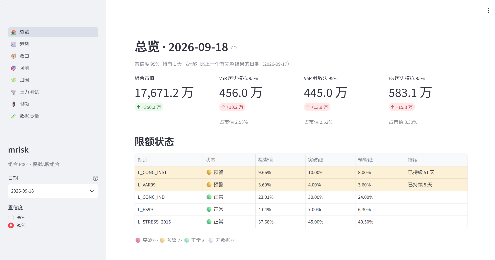
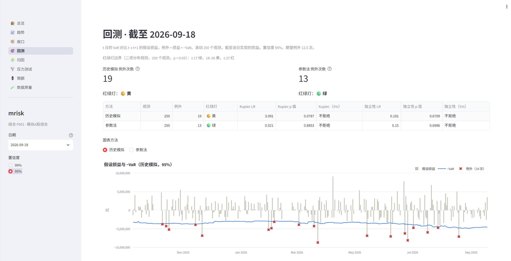
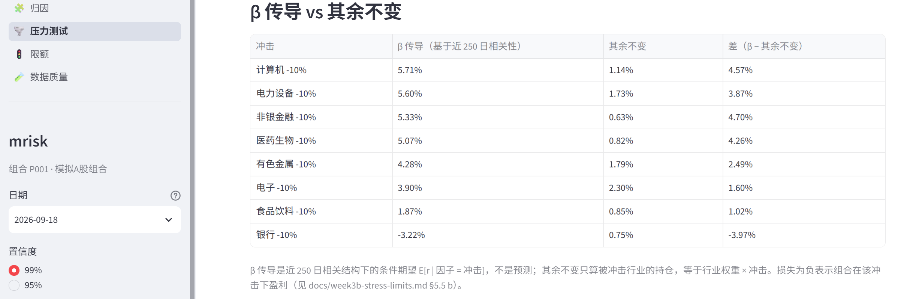
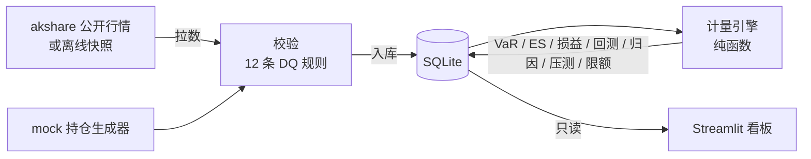

# mrisk — A 股股票组合的市场风险系统


*总览（2026-09-18，95%）：市值、历史模拟与参数法 VaR、ES 及对上一日的变动；5 条限额中 2 条预警，标出已持续天数。*


*回测（95%，滚动 250 个观测）：历史模拟 19 次例外、黄灯，参数法 13 次、绿灯；红绿灯边界由二项分布按 (p, 窗口) 推出。*


*压力测试：8 个行业各 −10% 时，β 传导（近 250 日相关结构下的条件期望）与"其余不变"的损失并排对比。*

**虚构组合在真实市场里的真实风险。** 行情是真的：经 akshare 取自公开网站的 A 股日线（2015-01 至 2026-09，81 只股票，含一只跨越 920 号段切换的北交所股票）。持仓是假的：由 mock 生成器造的 40 只股票的组合，2024-09-02 至 2026-09-18 共 497 个持仓日。系统每天回答四个问题：组合值多少钱、风险在哪里；明天最坏亏多少（VaR / ES，历史模拟法和参数法，95% 和 99%）；这个"最坏"靠不靠谱（Kupiec、Christoffersen、红绿灯回测）；有没有碰到红线（历史与假设情景压测、5 条限额）。

项目参考券商市场风险系统的典型功能，用公开方法论自己设计。

## 10 分钟上手（离线样例）

需要 [uv](https://docs.astral.sh/uv/) 和 Python 3.11+。

```sh
git clone https://github.com/wjx-chloe/mrisk.git
cd mrisk
uv sync
uv run mrisk fetch-snapshot                         # 下载行情快照（约 16 MB）并校验 sha256，唯一联网的一步
uv run mrisk demo                                   # 用快照跑完整条流程，写 data/demo.db，全程不联网
uv run mrisk --config config.demo.yaml dashboard    # 打开看板
```

- `fetch-snapshot` 从本仓库的 GitHub Release 下载 `mrisk-snapshot-20260918.zip`，按 `config.demo.yaml` 里记录的 sha256 校验，再逐个文件核对清单后解压到 `data/snapshot/`。
- `demo` 依次执行回灌（日历、证券、行情、mock 持仓、12 条 DQ 规则）→ VaR / ES → 假设损益 → 回测 → 归因 → 压测 → 限额，覆盖全部 497 个持仓日。本机实测约 3 分钟，其中压测约 100 秒。再跑一次要加 `--overwrite`。
- 离线跑出来的库与作者本机用实时数据建的库**逐表逐行、逐位相同**（`uv run mrisk diff-db data/mrisk.db data/demo.db`，只排除 `run_id` 等运行元数据），所以 docs 里的数字都能在 demo 库上复现。

### 看板只允许本机访问

`mrisk dashboard` 以仓库根目录为工作目录启动 Streamlit，并显式传 `--server.address localhost`、关闭使用统计，从哪个目录启动都一样。需要在局域网里打开时，单次运行指定地址：

```sh
uv run mrisk --config config.demo.yaml dashboard --address 0.0.0.0
```

## 数据流



数据只朝一个方向走：拉数 → 校验 → 入库；所有计算只从库里读，不在计算过程中现场拉行情。DQ 门禁拦下的日期不出风险结果，看板顶部会显示原因。

## 模块与文档

| 模块 | 代码 | 设计说明 |
|---|---|---|
| 数据管道：行情、证券主数据、920 号段映射、mock 持仓、12 条 DQ 规则与门禁 | `src/mrisk/data/`、`src/mrisk/jobs/etl.py`、`src/mrisk/jobs/gate.py` | [docs/week1-data-pipeline.md](docs/week1-data-pipeline.md) |
| 计量引擎：市值、收益率、VaR（历史模拟 / 参数法）、ES、个股 / 行业 / 组合三层 | `src/mrisk/engine/` | [docs/week2-engine.md](docs/week2-engine.md) |
| 回测与差异归因 | `src/mrisk/engine/backtest.py`、`src/mrisk/engine/attribution.py` | [docs/week3a-backtest-attribution.md](docs/week3a-backtest-attribution.md) |
| 压力测试与限额 | `src/mrisk/engine/stress.py`、`src/mrisk/limits/` | [docs/week3b-stress-limits.md](docs/week3b-stress-limits.md) |
| 监控看板（8 个页面） | `src/mrisk/dashboard/` | [docs/week4a-dashboard.md](docs/week4a-dashboard.md) |
| 离线快照、demo、回放核对 | `src/mrisk/data/snapshot.py`、`src/mrisk/jobs/demo.py`、`src/mrisk/db/compare.py` | [docs/week4b-offline-demo.md](docs/week4b-offline-demo.md) |

需求规格见 [SPEC.md](SPEC.md)。

## 切回 akshare 实时拉数

`config.yaml` 是实时配置（`data.source: akshare`，库在 `data/mrisk.db`）：

```sh
uv run mrisk backfill --end 2026-09-18   # 全量回灌：日历、证券、行情、持仓、DQ
uv run mrisk risk --start 2024-09-02 --end 2026-09-18   # 其余各步同理：pnl / backtest / attribution / stress / limits
uv run mrisk daily                       # 增量跑一天：拉数 → DQ → 门禁通过才算风险
uv run mrisk schedule                    # 每个工作日 16:30（北京时间）自动跑 daily
uv run mrisk dashboard
```

- akshare 是非官方数据源，会限流、会缺数据：拉数间隔 1 秒并带重试，原始返回缓存在 `data/raw/`。申万成分接口很慢，31 个行业约 25 分钟。
- 本机有 HTTPS 代理时访问国内行情站点可能握手失败，`data.bypass_proxy: true` 会在拉数时绕过代理。
- 从自己的缓存打离线快照：`uv run mrisk export-snapshot`。同一只股票的多个缓存区间重叠部分不一致时，不会挑一个，而是列出来并拒绝打包。

## 已知局限

- **持仓是 mock 的**，没有真实成交，回测只有假设损益。
- **停牌由缺行推断**，不是来自独立的停牌数据源。数据源漏掉个别股票时会被误标为停牌，覆盖率保护只挡得住整批缺失。
- **ST 按当前简称近似**，历史上戴过帽、现已摘帽的股票，当年的 5% 涨跌幅限制识别不了。
- **DQ 门禁按日期判断，不按股票**：任意一只股票的价格类规则失败，会拦下窗口覆盖这一天的所有风险日。偏保守。
- **压测的因子池是股票池内的 81 只**，不是市场指数；未上市、停牌的股票走同行业代理，代理平均无偏，单只股票不准。
- **假设情景每次只冲击一个因子**（`raw` 模式除外）。
- **历史模拟法 95%、99% 在样本期都偏激进**（例外偏多），见 4A 文档的回测四格表。
- **看板的只读只对 SQLite 生效**；换 PostgreSQL 要另配只读账号。
- 不做：债券 / 期权 / 期货、空头、权限与多用户、邮件告警（breach 只写日志并在看板红色高亮）。

## 开发

```sh
git config core.hooksPath .githooks              # 提交前跑测试，不过就拒绝提交
uv run pytest -q                                  # 全部测试（假数据，不联网）
MRISK_REGRESSION_DB=data/demo.db uv run pytest -m slow   # 在 demo 库上核对 docs 里的关键数字
```

## 数据来源与声明

行情经 akshare 取自公开网站，仅供学习研究，权利人要求即删除。持仓和组合均为虚构，不构成任何投资建议。
