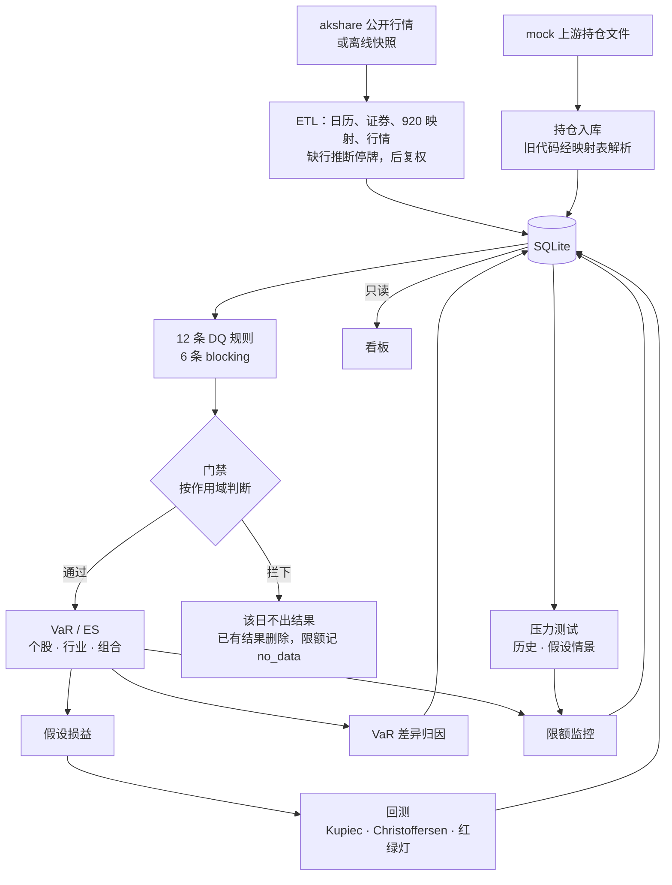

# mrisk 总览

A 股股票组合的市场风险系统。项目参考券商市场风险系统的典型功能，用公开方法论自己设计。

- **行情是真的**：经 akshare 取自公开网站，2015-01 至 2026-09，81 只股票。股票池是 8 个申万一级行业各 10 只，加上一只跨越 920 号段切换的北交所股票 BJ920682。
- **持仓是假的**：mock 生成器造的 40 只股票的组合，2024-09-02 至 2026-09-18，共 497 个持仓日。
- 算出来的是"虚构组合在真实市场里的真实风险"。

上手见 [README](../README.md)，需求见 [SPEC.md](../SPEC.md)，工作守则见 [CLAUDE.md](../CLAUDE.md)。

## 1. 架构

```text
src/mrisk/
├── data/        数据源（akshare / 离线快照）、证券主数据、920 号段映射、行情清洗、mock 持仓、12 条 DQ 规则
├── db/          表结构（17 张表）、读写、两库逐行比对
├── engine/      纯函数：市值、收益率、VaR / ES、损益、回测、归因、压测。只吃 DataFrame / ndarray，不碰库、文件、网络
├── limits/      限额规则的评估与种子
├── jobs/        把三者串起来：拉数 → 校验 → 入库；DQ 门禁与失效传递；各计算任务；daily / demo / 调度
├── dashboard/   Streamlit 看板，8 个页面，只读
└── cli.py       mrisk 命令
```

分层的规矩：

- **engine 是纯函数。** 读写库是 `db/` 和 `jobs/` 的事，所以引擎可以用手算的小样本直接测。
- **引擎里不按日期循环**，全部 NumPy 向量化。
- **所有计算只从库里读，不现场拉行情**：akshare 会限流、会缺数据。
- **看板不重算风险数字**，只展示任务写进库的结果，以只读方式打开库。

## 2. 数据流



- **每日顺序**（`mrisk daily`，每个工作日 16:30）：拉当天行情 → 生成并载入持仓 → DQ → 门禁 → 当日 VaR / ES → 前一持仓日的假设损益 → 回测 → 归因 → 压测 → 限额。
- **门禁的作用域**：6 条 blocking 规则按被检查的数据影响计算多久分三类。
  - 持仓类：1 天；
  - 价格类：251 天，坏价格会进入之后所有包含它的窗口；
  - 静态类：所有天。
  - 门禁和失效传递读同一份依赖声明，所以两者对"一次失败影响哪些结果"的判断总是一致。详见第 2 周文档 §8。
- **离线样例**：`fetch-snapshot` 下载并校验快照，`demo` 在快照上跑完全部步骤，结果与实时数据建的库逐位相同（第 4 周 B 文档 §5）。

## 3. 关键取舍

| 取舍 | 定了什么 | 出处 |
|---|---|---|
| 复权 | 用后复权价，历史值不随新的除权事件改变 | 第 1 周 §2 |
| 停牌 | 由缺行推断，加覆盖率保护，防止整批缺失被误标 | 第 1 周 §4 |
| 920 号段 | 一只股票一个主键，旧代码经 `instrument_code_map` 解析 | 第 1 周 §3 |
| 三层 VaR | 一个敞口矩阵覆盖个股、行业、组合三层；VaR 不满足次可加性，测试验证各层之和可以不等于组合（`tests/test_risk.py`） | 第 2 周 §2 |
| 窗口 | 250 个收益，历史不足或有缺口就报错，不缩短窗口 | 第 2 周 §3 |
| 归因 | 数量 → 重估（规模 + 权重漂移）→ 窗口，各部分之和精确等于总变化，有测试守着 | 第 3 周 A §2 |
| 红绿灯 | 边界由二项分布按 (p, 窗口长度) 推出：99% 为 ≤ 4 / 5–9 / ≥ 10，95% 为 ≤ 17 / 18–26 / ≥ 27 | 第 4 周规划 §1 |
| 压测代理 | 情景期内未上市或停牌的股票走同行业代理；平均无偏，单只不准 | 第 3 周 B §5.5 |
| 2015 情景限额 | 45%，warn 90%，按含代理部分的口径；原定 25% 不可行 | 第 3 周 B §5.3 |
| 离线快照 | 原始 akshare 帧原样保留，区间重叠不一致就拒绝打包 | 第 4 周 B §2 |

## 4. 关键数字（真实库，2024-09-02 至 2026-09-18）

- **回测**（496 个观测）：
  - 历史模拟 99% 例外 11 次（期望 5.0），全样本单侧 p = 0.0125；
  - 参数法 99% 例外 9 次，p = 0.0645；
  - 95% 的两种方法与期望没有显著差别；
  - 没有红灯。
- **2015 情景**：损失占市值 36.34%–41.51%。同期股票池等权跌三成多（不是指数）。
- **限额**：497 天 × 5 条 = 2,485 行，ok 2,055、warn 383、breach 47、no_data 0。
- **离线 demo**：全流程约 3 分钟，17 张表与真实库逐位相同。
- **测试**：251 个（假数据，不联网），另有 3 个 slow 回归测试，跑在 demo 库或真实库上。

## 5. 各周文档

| 文档 | 内容 |
|---|---|
| [第 1 周：数据管道](week1-data-pipeline.md) | 数据模型、akshare 拉数、920 号段、停牌推断、mock 持仓、12 条 DQ 规则 |
| [第 2 周：计量引擎](week2-engine.md) | 市值、收益率、历史模拟与参数法 VaR、ES、三层汇总；DQ 门禁的作用域 |
| [限额阈值参考材料](week2-limit-material.md) | VaR99 / ES99 占市值比例的分布与断崖，供第 3 周定阈值 |
| [第 3 周 A：回测与归因](week3a-backtest-attribution.md) | 假设损益、Kupiec / Christoffersen / 红绿灯、VaR 差异归因 |
| [第 3 周 B：压测与限额](week3b-stress-limits.md) | 历史与假设情景、代理路径、β 传导与其余不变、5 条限额与阈值的定法 |
| [第 4 周 A：看板](week4a-dashboard.md) | 8 个页面、默认日期与横幅、红绿灯按二项分布、回测四格表与全样本检验 |
| [第 4 周 B：离线样例](week4b-offline-demo.md) | 快照导出与校验、下载、demo、回放逐位相同、看板启动的安全默认 |
| [第 4 周规划与交接](week4-plan.md) | 本周拍板的决定、各子模块的原始规划、backlog |
