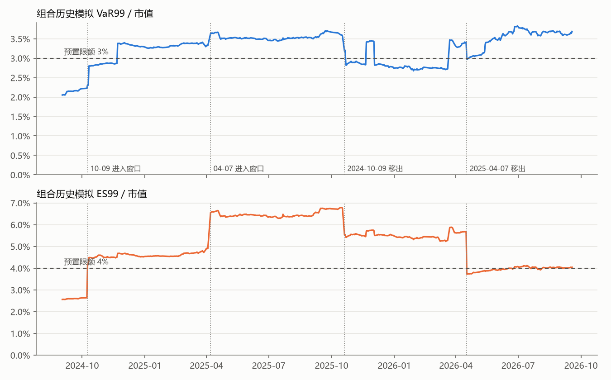
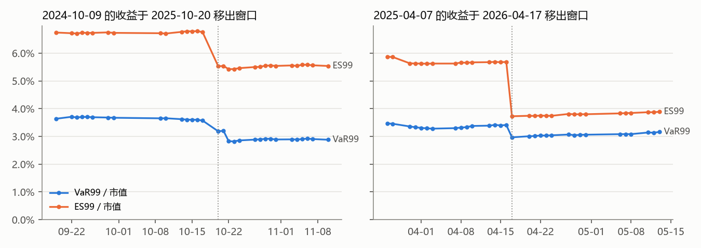

# 限额阈值参考材料：VaR99 / ES99 占市值比例（2024-09-02 至 2026-09-18）

> 用途：第 3 周规划时决定 SPEC §6.2 的 VaR、ES 限额阈值。本文只陈述数据和机制，不给阈值建议。
> 复现：`uv run --with matplotlib python notebooks/limit_material.py`。脚本只读库，不改引擎，也不写库。表格是脚本原样输出，图在 `docs/figures/`。
> 口径：组合层、历史模拟法、1 日、窗口 250 个收益率、简单收益，取 `risk_result` 中 confidence = 0.99 的行，比例 = 指标 ÷ 当日组合市值。

## 1. 结论先行

1. **预置限额在样本内大多数日子超限。** VaR99 > 3% 有 352 / 497 天（71%），ES99 > 4% 有 422 / 497 天（85%）。
2. **ES99 超限主要由两个事件日驱动，VaR99 超限不是。**
   - 窗口内只要含 2024-10-09 或 2025-04-07，ES99 每一天都超 4%；两者都移出后，超限比例降到 49%。
   - VaR99 正好相反：两者都移出后，超 3% 的比例反而是 99%，是全样本最高的一段。
3. **两个事件日移出窗口时都有断崖，而且完全来自窗口变化，与调仓无关。**
   - 2025-10-20（2024-10-09 移出）：ES99 −1.23 个百分点，VaR99 −0.39 个百分点；
   - 2026-04-17（2025-04-07 移出）：ES99 −1.96 个百分点（全样本最大的单日变动），VaR99 −0.45 个百分点。
   - 把持仓固定为前一日、只换窗口，得到的变动与实际变动相同。
4. **机制。** T = 250 时：
   - VaR99 = −(第 3 差 + 0.49 × (第 4 差 − 第 3 差))，看的是第 3、4 差的两天；
   - ES99 = 最差 3 天的平均。
   - 所以单个极端日只占 ES99 的 1/3 权重，它一进一出，ES99 就跳一个台阶；VaR99 对单个极端日不敏感，但对"一年里有几天跌超 3%"很敏感。

## 2. 时间序列

- 虚线是 SPEC §6.2 的预置限额；点线是两个事件日进入、移出窗口的日期。
- 两条曲线都是台阶形：只有当"最差几天"的组成发生变化时才会跳。

## 3. 分位数（占市值，497 天）

| 指标 | P50 | P75 | P90 | P95 | 最小 | 最大 |
|---|---|---|---|---|---|---|
| **VaR99（历史模拟）** | 3.38% | 3.53% | 3.66% | 3.69% | 2.05% | 3.83% |
| **ES99（历史模拟）** | 5.24% | 6.34% | 6.44% | 6.59% | 2.56% | 6.79% |
| VaR95（历史模拟） | 1.89% | 2.08% | 2.25% | 2.50% | 1.50% | 2.63% |
| ES95（历史模拟） | 3.02% | 3.30% | 3.36% | 3.48% | 1.91% | 3.54% |
| VaR99（参数法） | 3.62% | 3.84% | 3.91% | 3.98% | 2.37% | 4.14% |

- 前两行是你要的；后三行供对照。
- 阈值如果取某个分位数，样本内的超限率就直接等于 1 − 该分位，例如取 P90 就是 10% 的天数超限。
- ES99 不是连续分布，而是按窗口内有哪些大跌日分成几档台阶（§4 各段中位数）：事件前 2.6%、两者都已移出 4.0%、仅含 2024-10-09 4.6%、仅含 2025-04-07 5.5%、两者都在 6.4%。分位数其实是在这些台阶之间取值，所以 P50 和 P75 之间差了 1.1 个百分点。

## 4. 超限是否集中在含 2024-10-09 / 2025-04-07 的窗口

"窗口内含某日"指该日的收益属于 as-of 日的 250 个收益率之一。2024-10-09 的收益在窗口内的区间是 2024-10-09 至 2025-10-17，2025-04-07 的是 2025-04-07 至 2026-04-16。

| 窗口内含 | 日期范围 | 天数 | VaR99 > 3% 天数（占比） | ES99 > 4% 天数（占比） | VaR99 中位数 | ES99 中位数 |
|---|---|---|---|---|---|---|
| 都不在（事件前） | 2024-09-02 .. 2024-10-08 | 20 | 0（0%） | 0（0%） | 2.15% | 2.59% |
| 仅 2024-10-09 | 2024-10-09 .. 2025-04-03 | 120 | 88（73%） | 120（100%） | 3.31% | 4.56% |
| 两者都在 | 2025-04-07 .. 2025-10-17 | 130 | 130（100%） | 130（100%） | 3.52% | 6.43% |
| 仅 2025-04-07 | 2025-10-20 .. 2026-04-16 | 120 | 28（23%） | 120（100%） | 2.82% | 5.50% |
| 都不在（两者都已移出） | 2026-04-17 .. 2026-09-18 | 107 | 106（99%） | 52（49%） | 3.63% | 4.00% |
| 合计 | | 497 | 352（71%） | 422（85%） | 3.38% | 5.24% |

**ES99**：只要窗口内含任一事件日，就 100% 超 4%；两者都不在时，超限是 0%（事件前）和 49%（移出后）。ES99 的超限高度集中在事件窗口内。

**VaR99**：不集中。两者都移出后反而 99% 超 3%。原因是这段时间的窗口里攒了多个跌超 3.5% 的日子（见 §5），第 3、4 差的两天本身就超过 3%。

### 窗口尾部由哪些日子决定

按每个 as-of 日的当日持仓重估窗口损益，统计哪些日期落进"最差 3 天"（这 3 天决定 ES99，并与第 4 差一起决定 VaR99）：

| 日期 | 出现在最差 3 天的 as-of 天数 |
|---|---|
| 2024-10-09 | 250 |
| 2024-11-22 | 250 |
| 2025-04-07 | 250 |
| 2025-11-21 | 142 |
| 2025-10-17 | 125 |
| 2026-03-23 | 125 |
| 2024-10-11 | 97 |
| 2024-07-23 | 75 |

- **2024-10-09**：在窗口内的 250 天里，始终排在最差 3 天之内，其中 120 天排第 1。当天组合收益在 −7.35% 到 −6.42% 之间（随各 as-of 日的持仓不同而不同）。
- **2025-04-07**：在窗口内的 250 天里每天都排第 1。当天组合收益在 −9.72% 到 −8.52% 之间。
- **2024-11-22**（约 −3.8%）同样整整 250 天都在最差 3 天里。它进入窗口那天，VaR99 从 2.87% 跳到 3.38%，这是图中 2024-11 的台阶。

几个代表日的最差 3 天：

| as-of | VaR99 | ES99 | 最差 3 天（组合收益） |
|---|---|---|---|
| 2024-10-08 | 2.22% | 2.64% | 2024-07-23 −3.25%，2024-01-17 −2.39%，2024-01-22 −2.28% |
| 2025-10-17 | 3.57% | 6.76% | 2025-04-07 −9.40%，2024-10-09 −7.08%，2024-11-22 −3.80% |
| 2026-04-17 | 2.97% | 3.73% | 2026-03-23 −4.37%，2025-11-21 −3.74%，2025-10-17 −3.06% |
| 2026-09-18 | 3.69% | 4.04% | 2026-03-23 −4.46%，2026-06-26 −3.94%，2026-06-08 −3.74% |

## 5. 事件移出窗口时的断崖

### 2024-10-09 移出（2025-10-20）

| 日期 | VaR99 | ES99 | ΔVaR99 | ΔES99 |
|---|---|---|---|---|
| 2025-10-15 | 3.60% | 6.79% | −0.00% | +0.00% |
| 2025-10-16 | 3.60% | 6.79% | −0.00% | +0.00% |
| 2025-10-17 | 3.57% | 6.76% | −0.03% | −0.03% |
| **2025-10-20** | 3.18% | 5.53% | **−0.39%** | **−1.23%** |
| 2025-10-21 | 3.20% | 5.54% | +0.02% | +0.01% |
| 2025-10-22 | 2.82% | 5.42% | −0.38% | −0.12% |
| 2025-10-23 | 2.82% | 5.43% | −0.00% | +0.00% |

- 持仓固定为前一日、只换窗口：ΔVaR99 −0.39%，ΔES99 −1.23%，与实际变动相同。
- 在 496 个日变动中，按绝对值排序：|ΔVaR99| 排第 7，|ΔES99| 排第 4。
- 两天后（10-22）VaR99 又降了 0.38 个百分点，原因是 2024-10-11 也移出了窗口：它在 10-21 的窗口里排第 3 差（−3.37%）。

### 2025-04-07 移出（2026-04-17）

| 日期 | VaR99 | ES99 | ΔVaR99 | ΔES99 |
|---|---|---|---|---|
| 2026-04-14 | 3.41% | 5.68% | +0.03% | +0.01% |
| 2026-04-15 | 3.40% | 5.67% | −0.02% | −0.01% |
| 2026-04-16 | 3.41% | 5.68% | +0.01% | +0.01% |
| **2026-04-17** | 2.97% | 3.73% | **−0.45%** | **−1.96%** |
| 2026-04-20 | 3.01% | 3.74% | +0.04% | +0.02% |
| 2026-04-21 | 3.01% | 3.74% | +0.01% | −0.00% |
| 2026-04-22 | 3.03% | 3.75% | +0.02% | +0.01% |

- 持仓固定为前一日、只换窗口：ΔVaR99 −0.45%，ΔES99 −1.96%，与实际变动相同。
- |ΔVaR99| 排第 6，|ΔES99| 排第 1（全样本最大的单日变动）。
- ES99 一天之内从 5.68% 跌到 3.73%，正好从限额之上跌到限额之下。这类"日历性"的跨越不代表风险真的下降了，第 3 周设计限额监控和告警时可能要考虑。

## 6. 定阈值时可能需要考虑的点（只列问题，不给答案）

- **ES99 是 3 个观测的平均。** T = 250 时，它对单个极端日的进出极其敏感（§5）。阈值落在 §3 那几档台阶之间时，超限与否几乎完全由"窗口里有哪几个大跌日"决定，并在大跌日移出的那天整段翻转。
- **VaR99 对"跌超 3% 的天数"敏感。** 近一年这类天数增多，VaR99 抬升到 3.6% 左右，与两个事件日无关。3% 阈值在当前持仓结构下几乎每天触发。
- **warn = 80% 的规则。** 按 SPEC §6.2，warn 在阈值的 80% 处触发。以 VaR99 的 3% 为例，warn 线是 2.4%，样本内只有开头 22 天（2024-09-02 至 2024-10-10）低于它；ES99 的 4% 对应 warn 线 3.2%，也只有开头 20 天低于它。
- **样本只有约 2 年、一个组合。** 分位数会随持仓结构和市场阶段变化，上面的数字不是稳定的参数估计。
