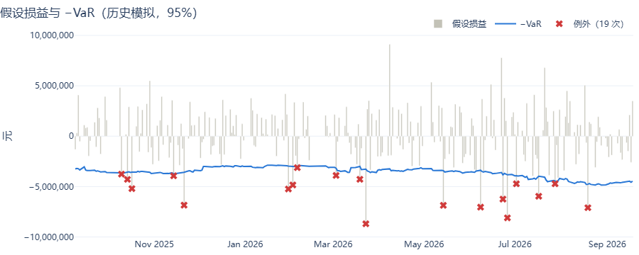
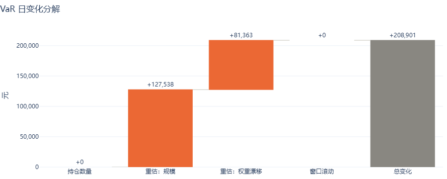
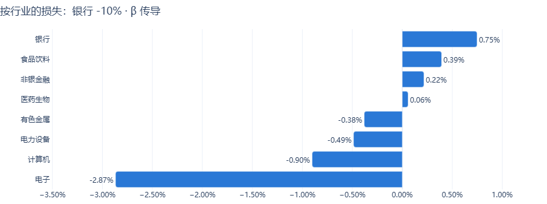

# 第 4 周 A 段：监控看板

## 1. 做了什么

```
config（MRISK_CONFIG）─► 数据库（SQLite 只读打开）
                          │
            dashboard/queries.py   只读取数：已入库的结果表 → DataFrame
            dashboard/transforms.py 纯函数：连续天数、区段、情景标签、并排对比
            dashboard/charts.py     Plotly：DataFrame → Figure
                          │
            dashboard/app.py（侧边栏、横幅、st.navigation）→ dashboard/views/*.py（8 个页面）
```

- 启动：在仓库根目录执行 `uv run streamlit run src/mrisk/dashboard/app.py`。
- **默认只有本机能访问**：仓库根目录的 `.streamlit/config.toml` 设了 `server.address = "localhost"`、`browser.gatherUsageStats = false`。
  - 实测：只监听 127.0.0.1，从局域网 IP 访问被拒绝。
  - 需要在局域网访问时，单次运行加 `--server.address 0.0.0.0`，不要改配置文件。
  - 这个配置文件只在从仓库根目录启动时生效，Streamlit 按启动时的当前目录找 `.streamlit/`。
- **看板只读，不重算风险。** 所有数字都来自 jobs 写入的表。SQLite 用 `mode=ro` 打开，写入会被数据库直接拒绝（有测试）。
- 为了支撑看板，本段对上游做了两处改动：
  - **回测**：红绿灯边界改为由二项分布规则按 (p, 窗口长度) 推出，所有方法和置信度都写 zone；
  - **压测**：新增 8 个"其余不变"（raw）情景。
- 依赖新增 `streamlit` 1.65、`plotly` 7.1（SPEC §8 已列出）。

## 2. 拍板决策的落地

| # | 决策 | 落地 |
|---|---|---|
| 1 | 默认日期 | "最新一个有完整结果的日期"：组合层 `risk_result` 在 config 的每个置信度上都有行，**且**每条 active 限额在当天都有 `limit_check` 行。侧边栏只列出这些日期 |
| 1 | 横幅 | 最新持仓日不完整时，在页面顶部显示横幅。被 DQ 门禁阻断时为红色，写明规则和日期；只是结果不全（任务没跑完或限额单独失败）时为黄色 |
| 2 | 红绿灯 | `engine.backtest.zone_bounds(p, n)`：X ~ B(n, p)，P(X ≤ k) < 95% 为绿，< 99.99% 为黄，其余为红。250 天下，99% 为 4 / 9，95% 为 17 / 26。job 给全部方法 × 置信度写 zone，SPEC §5.4 已同步 |
| 3 | 其余不变 | `scenario.json` 为每个行业冲击加一个 raw 版本（`IND_<行业>_-10_RAW`），走原有的压测 job。门禁里 raw 版本单独登记依赖：只依赖持仓日 t 的价格和持仓，不依赖 250 天窗口。SPEC §6.1 已同步 |
| 3 | 标明模式 | 每个情景标注"冲击"和"模式"（历史 / β 传导 / 其余不变）。同一个冲击的两个版本冲击名相同、模式不同，排名表里不会像两个不同的情景 |
| 4 | 持续天数 | 按持仓日历数连续天数。no_data 或缺行都会中断计数；N = 1 即"今日新触发" |
| – | 95% 红绿灯 | 不需要隐藏，直接按规则显示 |
| – | 代理股 | 压测下钻时，走代理路径的股票不显示单股数字（显示"—"，整行置灰，注明原因）；它们的损失仍计入行业和组合合计 |
| – | 条件传导 | β 传导和其余不变两列并排；β 一列的列名写明"基于近 250 日相关性" |

## 3. 关键设计

### 3.1 8 个页面

| 页面 | 内容 | 数据来源 |
|---|---|---|
| 总览 | 市值、VaR（历史模拟、参数法）、ES，与上一个完整日期的变动；限额状态灯 | `risk_result`、`limit_check` |
| 趋势 | VaR / ES 金额、市值、VaR / ES 占市值，三张图；区间可选近 1 月、3 月、半年、1 年 | `risk_result` |
| 敞口 | 行业条形图、个股 top 10 | `risk_result` 的行业和个股行 |
| 回测 | 两种方法的例外次数、红绿灯、Kupiec 和独立性检验；损益与 −VaR 对照图；例外日历；例外明细 | `backtest_result`、`pnl_hypo`、`risk_result` |
| 归因 | 四项效应的瀑布图、个股贡献 top 10；指标可选 | `var_attribution` |
| 压力测试 | 重大损失 top N（标明模式）、β 传导 vs 其余不变并排、情景下钻（行业图 + 个股表） | `stress_result`、`scenario` |
| 限额 | 今日新触发 / 持续中 / 突破计数、当日检查（超线成员可展开）、历史突破和预警区段、单条规则的检查值历史、规则列表 | `limit_check`、`limit_rule` |
| 数据质量 | 当日 12 条规则的结果和失败明细、各类结果的门禁状态 | `dq_result`、`dq_rule`、`jobs/gate.dq_gate` |

- **回测页的日期**：所选日期 d 是窗口最后一个观测的实现日，看的是"截至 d 已实现的损益"，与 `backtest_result.asof_date` 的口径一致。
- **门禁状态**：
  - 假设损益取"当日实现"的那一笔（持仓日为 d 的前一交易日）。d 自己的损益要等下一交易日才实现，直接问 d 永远是 no_dq。
  - 历史情景各有自己的固定日期，所以逐个检查后显示最差的一个；β 传导和其余不变两类，同类内各情景的依赖相同，只问一个。
  - 这一步耗时约 3.7 秒（9 次门禁调用），页面缓存 10 分钟。

### 3.2 状态表达与配色

- **状态一律用图标加文字**（🔴 突破、🟡 预警、🟢 正常、⚪ 无数据；红绿灯用 🟢 绿、🟡 黄、🔴 红），不只靠颜色区分；表格里 breach 行底色为红，warn 行为琥珀色（SPEC §6.3）。
- 图表配色：
  - 序列按固定顺序取分类色；
  - 状态色（good / warning / critical）只用于状态：例外点、突破点、红绿灯；
  - 每张图只有一个 y 轴。量纲不同的指标拆成两张图，比如 VaR 金额和 VaR 占市值。
- **两处按实际渲染效果修过**：
  - 瀑布图原来从昨日的 VaR 水平起步，0.2M 的效应在 6.3M 的底座上几乎看不见，改为只分解"变化"，以总变化收尾；总变化柱的标签取各项之和。
  - 条形图给两侧的柱外标签留了空间，原来最长的负值标签会压到行业名上。

### 3.3 其余不变情景与门禁

- `jobs/gate.stress_entry(type, definition)` 把每个情景映射到三类依赖之一：
  - `historical`：持仓日 t + 情景实际读到的价格日；
  - `hypothetical`：β 估计用的 250 天窗口 + 持仓日 t；
  - `raw`：只依赖持仓日 t。

  压测 job、限额 job 和失效传递都通过它查依赖，三处口径一致。
- 窗口内某天的价格出错，会拦下 β 传导版，但其余不变版照常计算（有测试）。
- **顺手修了两个潜在 bug**：
  1. 带 key 的依赖项如果 key 列表为空（例如种子里没有任何假设情景），`invalidate` 会退化成不带 key 的删除，把受影响日期上**所有**情景的压测行都删掉。已改为"没有 key 就不删"，并加了回归测试；把旧写法放回去，这个测试会失败。
  2. 假设情景集合为空时，`hyp[[]]` 选中的是 0 列而不是 0 行。已改为按情景 ID 集合判断。

## 4. 怎么验证的

`uv run pytest`：共 228 个测试，全部通过（3B 收尾时 201 个，本段新增 27 个）。

- **纯函数（手算）**：
  - 连续天数：no_data 中断、缺行中断、最后一天缺行为 0；
  - 区段：起止日期、天数、峰值；
  - 情景标签：β 版和 raw 版冲击名相同；
  - 并排对比：只保留两个版本都有的冲击；
  - 例外日历的周和星期。
- **红绿灯边界**：250 天下 99% 为 (4, 9)、95% 为 (17, 26)；手算小例 n = 2、p = 0.5 为 (1, 1)，n = 1、p = 0.06 为 (0, 0)；job 测试改为验证四个方法 × 置信度组合的 zone 都与规则一致。
- **图表（检查 `Figure.data`）**：
  - 例外点恰好是严格小于 −VaR 的那几天；
  - 线条颜色按分类色顺序取，只有一个 y 轴；
  - 瀑布图的步长和合计标签正确；
  - 条形图两侧留出标签空间；
  - 日历的格子位置正确；
  - 限额图的突破点和两条阈值线正确。
- **查询**：在完整计算过的假数据世界上测（全部 job 都跑过；窗口 5 天，回测窗口 15 天，所以有回测结果）：
  - 删掉某天一条规则的检查，或某天一个置信度的风险结果，该日就退出完整日期；
  - 最新日注入 DQ03 失败并执行失效传递后，横幅为红色并写明 DQ03；
  - 持续天数被 no_data 和 ok 打断后的计数，以及突破区段的拆分；
  - 敞口占比之和为 1，行业市值等于个股之和；
  - 95% 的 zone 与规则一致，例外数与观测复算一致；
  - 代理标记：假数据里唯一停牌的股票没被持有过，所以测试把某只持仓的压测行标为代理，以确定性地覆盖这段逻辑；
  - 只读引擎拒绝写入。
- **页面（AppTest）**：
  - 8 个页面在 99% 和 95% 下都能跑通，没有异常；
  - 总览的指标值、日变动和限额状态灯，与库里逐项相等；
  - 切到 95% 后数字随之变化；
  - 95% 回测页显示 15 天窗口下的二项分布边界；
  - 限额页区分"今日新触发"和"已持续 N 天"；
  - 压测页的排名带模式，并排表只列银行，代理股的数字为"—"；
  - 最新日被阻断时出现红色横幅，默认日期退到前一天。
- 确认过：Streamlit 1.65 的 AppTest 支持 `st.navigation`，但页面必须是文件（`switch_page` 按文件路径切换），所以页面放在 `views/*.py`。
- **真实服务**：`streamlit run` 无头启动，健康检查 ok，首页 200。
- **图表渲染**：用 kaleido 在临时环境里把真实库的 6 张图渲染成 PNG，逐张看过，发现并修了 §3.2 的两处问题。kaleido 没有加进项目依赖。

## 5. 真实库结果（2024-09-02 至 2026-09-18）

- 完整日期 497 个，最新为 2026-09-18，没有横幅。
- **页面耗时**（AppTest，热启动）：大多 0.2–0.7 秒；回测页、数据质量页首次约 4.5 秒（数据质量页主要花在门禁检查上，之后走缓存）。
- **红绿灯重算**（247 个回测日）：

| 方法 × 置信度 | 绿 | 黄 | 红 | 例外数范围 |
|---|---|---|---|---|
| 历史模拟 99% | 173 | 74 | 0 | 2–7 |
| 历史模拟 95% | 201 | 46 | 0 | 8–20 |
| 参数法 99% | 186 | 61 | 0 | 2–6 |
| 参数法 95% | 247 | 0 | 0 | 3–13 |

- **2026-09-18 的 β 传导 vs 其余不变**（损失占市值）：

| 冲击 | β 传导 | 其余不变 |
|---|---|---|
| 计算机 −10% | 5.71% | 1.14% |
| 电力设备 −10% | 5.60% | 1.73% |
| 非银金融 −10% | 5.33% | 0.63% |
| 医药生物 −10% | 5.07% | 0.82% |
| 有色金属 −10% | 4.28% | 1.79% |
| 电子 −10% | 3.90% | 2.30% |
| 食品饮料 −10% | 1.87% | 0.85% |
| 银行 −10% | −3.22%（盈利） | 0.75% |

  其余不变 = 行业权重 × 10%，与 3B 文档 §5.2 的口算一致。
- **当日限额**：L_CONC_INST 预警，已持续 51 天；L_VAR99 预警，已持续 5 天；其余正常。
- 压测和限额重跑后结果不变（限额仍是 ok 2,055、warn 383、breach 47）。





## 6. 已知局限

1. **只读只对 SQLite 生效。** 换 PostgreSQL 时要给看板配一个只读账号。
2. **其余不变版本只配了行业冲击。** 全市场冲击没有 raw 版本（"其余不变"对全市场冲击没有意义），所以并排对比只有 8 个行业。
3. **门禁状态的计算较慢**（约 3.7 秒，缓存 10 分钟），慢在 `dq_gate` 每次调用都要重读日历和 DQ 结果，没有改 gate 本身。
4. **测试耗时波动大**：同样的测试集，在这台机器上要 65–215 秒，取决于负载。pre-commit hook 跑的是全量，本身就要一分钟以上。
5. **代理标记的粒度**：只要情景期内有一天走代理（未上市或停牌），整只股票就标为代理，不区分代理天数的多少。
6. **图表的视觉检查靠人工**：渲染成 PNG 看，没有自动化的截图测试。
